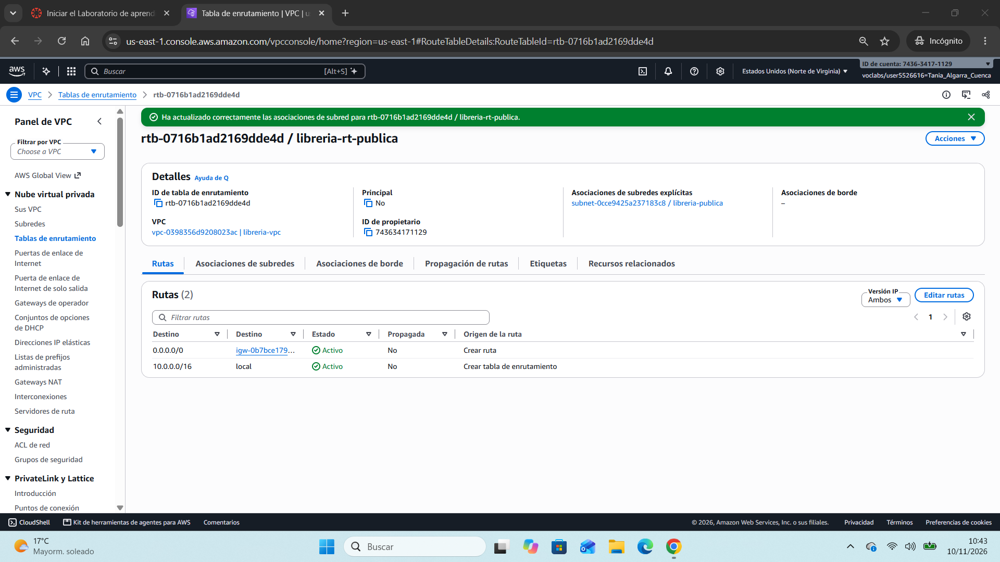
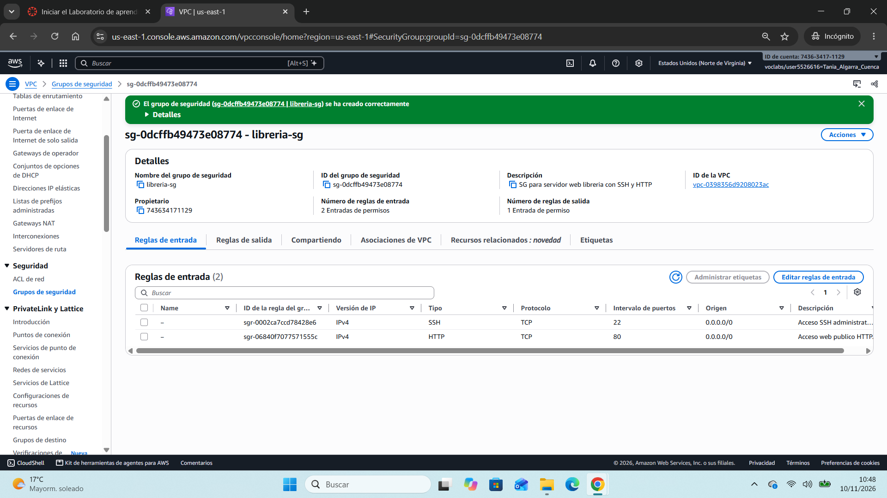
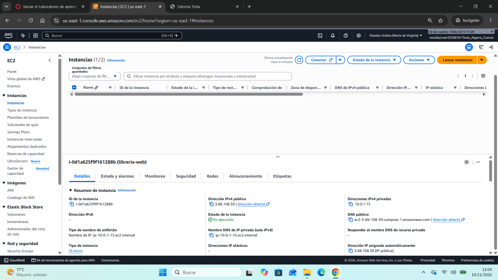
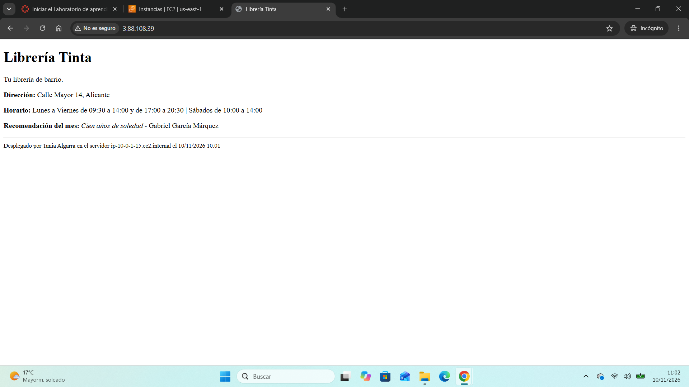
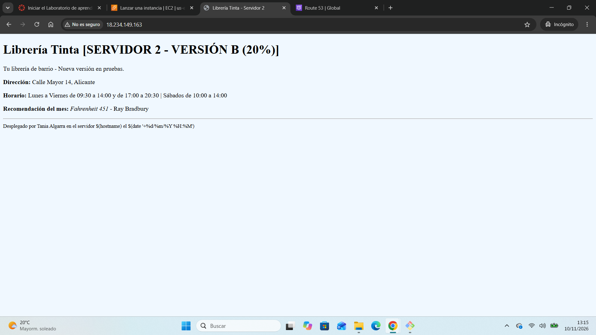
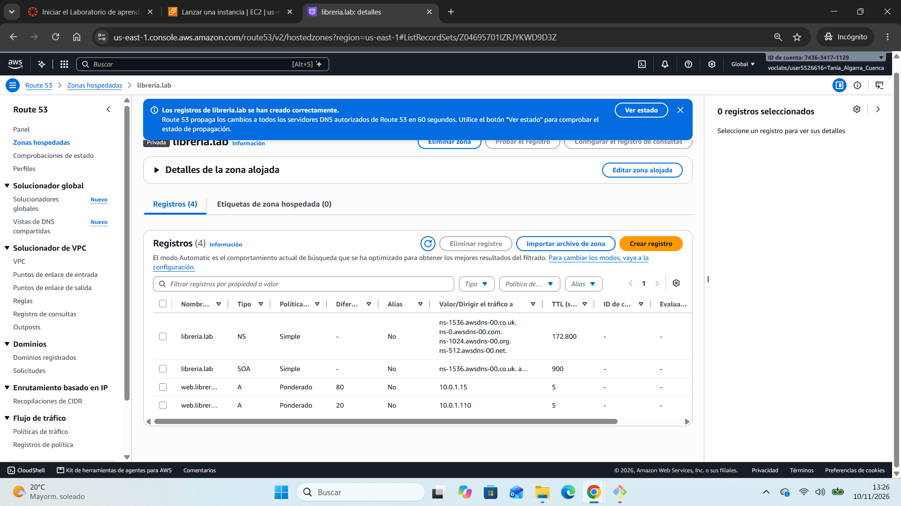
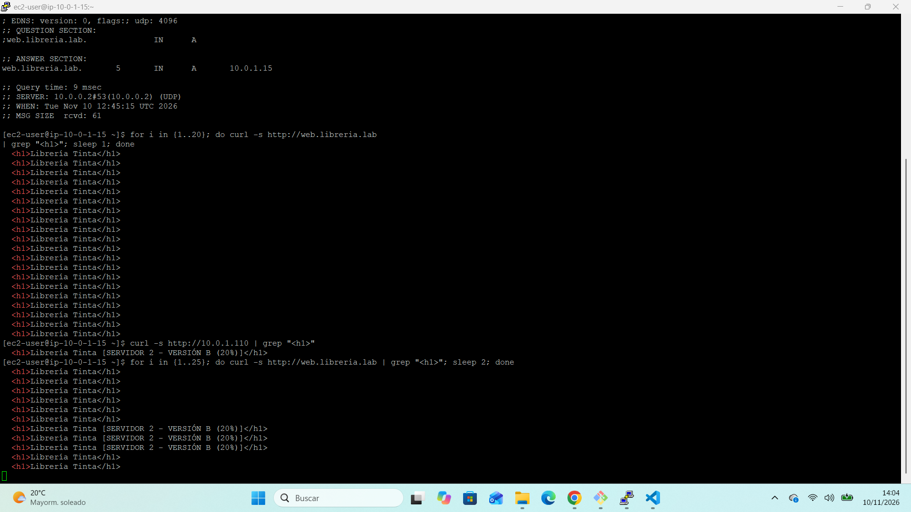
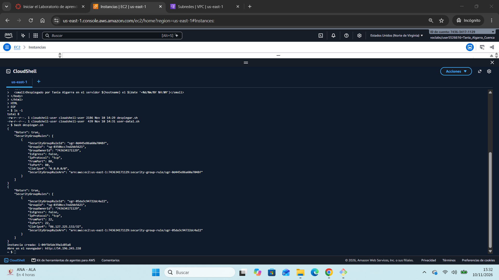
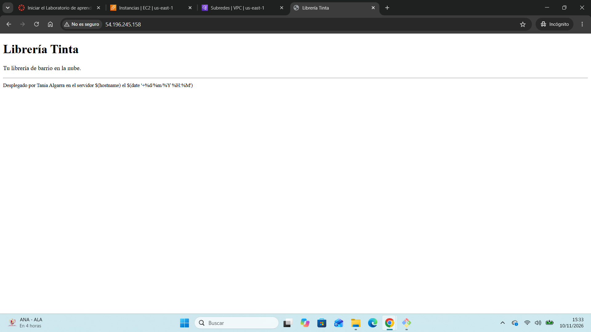

# proyecto1
Proyecto 1: Despliegue de infraestructura web y alta disponibilidad en AWS con CLI y Route 53 (2º DAW - Nube Pública)

## Nivel Básico

### B1. Configuración de Red
Se ha creado una VPC dedicada (`libreria-vpc`) con bloque CIDR `10.0.0.0/16`, una subred pública (`libreria-publica`) en `us-east-1a` con auto-asignación de IPv4 pública habilitada, un Internet Gateway (`libreria-igw`) conectado a la VPC y una tabla de rutas (`libreria-rt-publica`) asociada a la subred con salida directa a Internet (`0.0.0.0/0`).

La subred es pública porque su tabla de rutas redirige el tráfico hacia el Internet Gateway y asigna direcciones IPv4 públicas a las instancias. Esto permite que cualquier usuario desde Internet pueda conectarse y visualizar la página web del servidor.

### B2. Grupo de Seguridad
Se ha creado el Security Group `libreria-sg` dentro de `libreria-vpc` con dos reglas de entrada:
- **HTTP (puerto 80):** Abierto a todo el mundo (`0.0.0.0/0`) para permitir el acceso web público.
- **SSH (puerto 22):** Restringido únicamente a mi dirección IP pública (`Mi IP /32`).

El acceso por SSH se limita a mi IP para proteger la administración del servidor frente a intentos de intrusión y ataques de fuerza bruta externos, asegurando que solo yo pueda iniciar sesión remota en la máquina.

### B3. El Servidor Web
Se ha desplegado la instancia EC2 `libreria-web` (`t3.micro`) sobre Amazon Linux 2023 en la subred pública `libreria-publica`, configurada con el Security Group `libreria-sg` y etiquetada con `Proyecto=P1` y `Alumno=Tania Algarra`.

A través del script de *User Data*, el servidor instaló e inició Nginx de forma desatendida, sirviendo la web corporativa de la librería:

### B4. Cálculo de Costes
Se ha realizado la estimación de costes con **AWS Pricing Calculator** para mantener la instancia `libreria-web` (`t3.micro` bajo demanda con disco EBS gp3 en la región `us-east-1`) encendida 24/7 (730 horas/mes):

- **Coste mensual estimado:** 8,23 USD/mes.
- **Enlace a la estimación pública:** [Estimación AWS Pricing Calculator](https://calculator.aws/#/estimate?id=fc3b379bd28c6dae67edce243333f34138e9bce6)

**Explicación del presupuesto del servicio:**
El presupuesto del nivel básico contempla el coste mínimo para mantener una aplicación web en producción continua (730 horas al mes). La gran mayoría del gasto procede del cómputo de la máquina virtual t3.micro (~7,59 USD/mes), mientras que el almacenamiento en el disco EBS de 8 GB supone un coste residual (~0,64 USD/mes). Al tratarse de una arquitectura simple sin balanceadores ni servicios administrados complejos, representa una opción muy económica para poner en marcha la web de la librería.

**Optimización de costes:**
Para abaratar este servicio se podría programar el apagado automático de la máquina fuera del horario laboral de la librería mediante AWS Lambda o Instance Scheduler.

---

## Nivel Medio

### M1. DNS y Alta Disponibilidad con Route 53

Para implementar alta disponibilidad y reparto de tráfico en la red privada, se ha desplegado una segunda versión del sitio web y se ha configurado un balanceo mediante DNS ponderado.

#### 1. Segundo Servidor Web (`libreria-web-2`)
Se ha lanzado una segunda instancia EC2 con la misma configuración base que la principal (tipo `t3.micro`, Amazon Linux 2023, subred `libreria-publica` y el Security Group `libreria-sg`). En sus datos de usuario (*User Data*, disponible en `scripts/user-data2.sh`) se ha personalizado el título principal a `<h1>Librería Tinta [SERVIDOR 2 - VERSIÓN B (20%)]</h1>` para distinguir las respuestas de ambos servidores.

#### 2. Configuración de Route 53 (Zona Privada y Routing Ponderado)
- **Zona Privada:** Se ha creado la Private Hosted Zone `libreria.lab` asociada a `libreria-vpc` (tras verificar previamente que la VPC tiene activadas las opciones de *Resolución de DNS* y *Nombres de host DNS*).
- **Registros ponderados:** Dentro de la zona privada se crearon dos registros de tipo `A` para el nombre `web.libreria.lab`:
  - **Servidor 1:** Apunta a la IP privada `10.0.1.15`, con ID `servidor-1`, peso `80` y TTL de `5 segundos`.
  - **Servidor 2:** Apunta a la IP privada `10.0.1.110`, con ID `servidor-2`, peso `20` y TTL de `5 segundos`.

#### 3. Comprobación de DNS y balanceo
Al tratarse de una zona DNS privada, la resolución solo opera dentro de la VPC. Se accedió por SSH a la instancia `libreria-web` y se ejecutaron las siguientes pruebas:
- **Resolución con `dig`:** La consulta a `web.libreria.lab` resuelve de manera interna a través del resolver DNS de AWS (`10.0.0.2#53`).
- **Prueba de tráfico con `curl`:** Se ejecutó un bucle de 25 peticiones consecutivas con pausas de 2 segundos para permitir la expiración del TTL de 5 s. En la salida se comprueba cómo el tráfico se reparte entre la versión principal (Servidor 1) y la Versión B (Servidor 2).

### M2. Actualización de costes del proyecto (Nivel Medio)

Se ha actualizado la estimación económica en **AWS Pricing Calculator** para reflejar la infraestructura redundante en la región `us-east-1` (Norte de Virginia) manteniendo ambos servidores activos 24/7 y el servicio de nombres privado:

- **Enlace a la estimación oficial:** [AWS Pricing Calculator - Nivel Medio](https://calculator.aws/#/estimate?id=bb8aa63387903949d2709d3498d9f10fd33dc452)
- **Coste mensual estimado:** **16,96 USD / mes**
- **Coste total anual (12 meses):** **203,52 USD** (Coste inicial: 0,00 USD)

#### Desglose por servicio:
| Servicio | Configuración | Coste mensual |
| :--- | :--- | :--- |
| **Amazon EC2** | 2 instancias `t3.micro` (730 h/mes c/u) + 2 volúmenes raíz EBS de 8 GB (gp3) | 16,46 USD |
| **Amazon Route 53** | 1 Private Hosted Zone (`libreria.lab`) + consultas DNS estándar | 0,50 USD |
| **Total Nivel Medio** | *(Servidor 1 + Servidor 2 + Zona Privada)* | **16,96 USD / mes** |

**Justificación y optimización:**
El presupuesto se duplica respecto al nivel básico debido a la adición del segundo servidor de cómputo y su almacenamiento EBS (~8,23 USD/mes adicionales). En contraste, el servicio DNS de Route 53 representa un gasto fijo muy reducido (0,50 USD/mes por la zona privada). 
Para optimizarlo a largo plazo se podrían aplicar **Instancias Reservadas** si la arquitectura se mantiene durante 1 a 3 años, o utilizar instancias **Spot** para el servidor que atiende el porcentaje minoritario de tráfico.

---

## Nivel Avanzado

### A1. Automatización del Despliegue con AWS CLI

Se ha completado el script en Bash (`scripts/desplegar.sh`) siguiendo la plantilla oficial para automatizar de forma desatendida el aprovisionamiento de la infraestructura web:
- Consulta dinámica del identificador más reciente de la AMI de Amazon Linux 2023 mediante AWS Systems Manager (`aws ssm get-parameters`).
- Creación de un Security Group dedicado (`libreria-web-cli-sg`) en `libreria-vpc`.
- Apertura del puerto 80 (HTTP) para todo el tráfico (`0.0.0.0/0`) y del puerto 22 (SSH) restringido exclusivamente a mi IP pública (`86.127.225.132/32`).
- Lanzamiento de la instancia EC2 `libreria-web-cli` (`t3.micro`) en la subred pública asociada al par de claves `vockey` e inyección del script de inicio `user-data1.sh`.
- Espera activa con `aws ec2 wait instance-running` y obtención de la IP pública asignada.

#### Comprobación de la ejecución del script:

#### Comprobación del servidor web desplegado por CLI:

---

## Uso de Inteligencia Artificial
En el desarrollo de esta práctica se ha utilizado un asistente de IA como apoyo técnico y de resolución de incidencias:
1. **Herramienta:** Asistente de IA (Gemini).
2. **Prompts útiles:**
   - *"¿Por qué al ejecutar el bucle curl contra web.libreria.lab solo me responde el servidor 1 y cómo puedo verificar que el balanceo ponderado de Route 53 funciona?"*
   - *"¿Cómo debo rellenar los bloques TODO del script desplegar.sh respetando la estructura oficial y los comandos de la guía de la terminal de AWS?"*
3. **Propuestas incorrectas detectadas y corrección:**
   - **Costes:** La IA sugirió inicialmente presupuestar instancias `t2.micro` en la calculadora de costes para el nivel medio. Se contrastó con los requisitos oficiales y se corrigió a `t3.micro` con volúmenes gp3.
   - **Parámetros redundantes en CLI:** La IA sugirió añadir parámetros manuales como `> /dev/null` o cambiar el comando de SSM por `describe-images`. Se descartó esa modificación para mantener la plantilla original de la profesora intacta, identificando que el entorno ideal para ejecutar sin problemas de conversión de rutas de Windows era AWS CloudShell.

